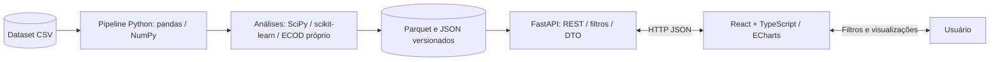

# QuadraScope — Arquitetura de produto

> Plataforma web de NBA Analytics desenvolvida para o Projeto 1 de Laboratório de Ciência de Dados (UFAPE, 2026.2). Nome provisório.

## Proposta do produto

Uma plataforma interativa e intuitiva para explorar os dados de desempenho por time e partida da NBA, com métodos estatísticos auditáveis, interpretações claras e visualizações modernas.

## Auditoria inicial da base

Arquivo: `stats_times_regular_final.csv`. 2.238 linhas, 28 colunas, 30 times, 1.119 partidas (2 linhas/partida). Período de 2025-10-21 a 2026-03-29; cobertura parcial da temporada regular 2025–26; 74–76 jogos por time. Na inspeção inicial, não foram identificados valores ausentes, duplicatas de linha, duplicatas de (`Team_ID`, `Game_ID`) ou discrepâncias na identidade de pontos `2*FGM + FG3M + FTM = PTS` e rebotes `OREB + DREB = REB`. Há 33 jogos com zero tocos e um jogo com zero roubos, potencialmente legítimos. `Game_ID` e `Team_ID` são identificadores; preservá-los como strings. `W`, `L` e `W_PCT` descrevem o acumulado da temporada, enquanto `WL` indica a vitória ou derrota na partida.

## Tecnologias

| Área | Decisão |
| --- | --- |
| Frontend | React + TypeScript + Vite |
| Design | Tailwind CSS + shadcn/ui + Radix UI |
| Visualização | Apache ECharts + `echarts-for-react` |
| Tabelas | TanStack Table |
| Cache e API | TanStack Query + `fetch` |
| Navegação | React Router |
| Backend | Python + FastAPI + Pydantic |
| Data Science | **pandas, NumPy, scikit-learn e SciPy** — sem PyOD |
| Persistência | CSV original, dados limpos em Parquet, resultados em JSON; sem banco inicialmente |
| Testes | pytest (cálculos e API), Vitest (UI) |
| Estilo e lint | Ruff, ESLint, Prettier |
| Deploy | Vercel (preferência: Vercel Services; alternativa: dois projetos Vercel) |

## Diagrama

Veja `quadrascope-arquitetura.svg`. Visão lógica: dataset CSV → pipeline offline Python → dados normalizados/relatórios JSON → FastAPI → React/ECharts → usuário. A API calcula métricas simples sob demanda e consulta análises avançadas previamente processadas; toda métrica científica é definida e validada no Python, não no navegador.



## Navegação — 6 páginas com linguagem de produto

1. **Panorama** (`/`): visão geral, rankings, destaques da temporada e cartões de indicadores; conteúdo contextual e chamadas para análises.
2. **Times** (`/times` e `/times/:id`): perfil de cada time, médias, dispersão, distribuições, quartis, boxplot, assimetria e CV; filtros de intervalo, condição casa/fora e vitória/derrota.
3. **Comparar** (`/comparar`): 2 a 4 times selecionados, barras de medidas na mesma unidade, diferenças, tabelas de CV e IQR; comparação de resultados, não previsão.
4. **Evolução** (`/evolucao`): séries temporais com jogo/data, tendência de pontos, rebotes e assistências; média móvel identificada como derivada; contextualização com o adversário.
5. **Fora da Curva** (`/fora-da-curva`): partidas anômalas com filtros por método (Z-score, IQR, Grubbs, ECOD, KNN, DBSCAN, LOF), registros afetados e explicação dos parâmetros.
6. **Sobre os Dados** (`/dados`): fonte, escopo, período, dicionário, transformações, incompletudes, consistências, testes de missingness e fórmulas/decisões metodológicas.

O relatório acadêmico existe **dentro** dessas páginas. Cada visualização relevante inclui o bloco contextual `O que isso significa?`, detalhamento de cálculo e limitações.

## Requisitos científicos / métodos

- Estatísticas: pandas/NumPy para média, mediana, moda, mínimo, máximo, variância, desvio padrão amostral (ddof=1), quartis, IQR e CV; reportar unidades e critérios.
- Assimetria: SciPy `scipy.stats.skew` com convenção ajustada documentada; SciPy `gaussian_kde` para densidade em histogramas.
- Outliers univariados: z-score com critérios divulgados e IQR com limites Q1±k*IQR (normalmente k=1,5); teste de Grubbs com valor crítico baseado na distribuição t de Student e observações sobre normalidade/multiplicidade.
- Outliers multivariados: scikit-learn `NearestNeighbors` para escore k-NN, `DBSCAN` para pontos com rótulo -1 e `LocalOutlierFactor` para LOF; definir e registrar escalonamento, variáveis, limiares, vizinhos e tolerâncias.
- ECOD: **implementar especificamente** a pontuação de anomalia baseada nas caudas da CDF empírica; documentar tratamento de empates e assimetria e testar por exemplos conhecidos. O algoritmo não está disponível como detector nativo em scikit-learn.
- Qualidade/missingness: base inspecionada possui zero valores ausentes; portanto testes como Little, Jamshidian–Jalal, Listing–Schlitgen e a abordagem de Fairclough devem ser explicados e contextualizados. Sua execução nessa base pode ser inaplicável/sem poder informativo; se for necessária demonstração, separar dados sintéticos dos resultados do dataset original. Little/Grubbs usam funções de probabilidade de SciPy.
- Respeitar o escopo da base: sem dados de jogadores, localização de arremessos, posse a posse ou rastreamento. Com pareamento por Game_ID podemos derivar pontos do adversário e saldo de pontos.

## Padrões

- `GAME_DATE` como `datetime` (ISO 8601); `Team_ID` e `Game_ID` como identificadores de texto.
- `WL` como booleano/rótulo contextual, `W` e `L` como contadores acumulados; não misturar `W_PCT` com win rate agregado sem esclarecer a fórmula.
- Nome de coluna legível e rótulo de unidade amigável; chaves originais preservadas na proveniência.
- API retorna números sem arredondar e metadados `unit`, `method`, `parameters`, `n`, `period`; UI formata casas decimais.
- Não declarar um valor zero como missing/outlier por padrão.
- Quartis e limites dos boxplots calculados **exclusivamente no Python** e enviados como parâmetros para ECharts; evitar diferença entre convenções da biblioteca de visualização e pipeline.
- Resultados científicos devem permanecer reproduzíveis usando versão de dataset, código, dependências e parâmetros.

## Contratos de API sugeridos

- `GET /api/v1/meta` — metadados, cobertura, dicionário, versão da base.
- `GET /api/v1/teams` — lista dos 30 times e resumos.
- `GET /api/v1/teams/{team_id}/summary?from=YYYY-MM-DD&to=YYYY-MM-DD` — indicadores e filtros.
- `GET /api/v1/distributions?team_id=...&metric=PTS` — dados para histograma, KDE, boxplot e metadados estatísticos.
- `GET /api/v1/comparisons?team_ids=...&metric=PTS` — estatísticas comparáveis.
- `GET /api/v1/trends?team_id=...&metric=PTS` — observações por partida e tendência.
- `GET /api/v1/anomalies?team_id=...&method=lof&metric=PTS` — eventos fora da curva, scores e parâmetros.
- `GET /api/v1/quality` — verificações de qualidade e decisões de tratamento.

Filtros cuja combinação não tenha resultados pré-computados devem: (1) realizar cálculos baratos sob demanda, (2) recalcular criteriosamente onde viável ou (3) apresentar limite transparente. Nunca reutilizar scores de uma população sob outra seleção como se fossem equivalentes.

## Organização do repositório

```text
quadrascope/
├── frontend/
│   └── src/
│       ├── app/                 # roteador, providers e layout
│       ├── features/            # panorama, teams, compare, trends, anomalies, data
│       ├── components/          # design system e ECharts wrappers
│       ├── lib/                 # cliente HTTP, helpers e formatação
│       └── types/               # contratos de API
├── backend/
│   ├── app/
│   │   ├── api/v1/             # endpoints
│   │   ├── schemas/            # contratos Pydantic
│   │   └── services/           # casos de uso
│   ├── analytics/              # cleaning, quality, descriptive, anomaly, distribution
│   ├── scripts/                # build dos artefatos
│   ├── tests/
│   ├── data/raw/
│   └── data/processed/
├── docs/
│   ├── architecture.md
│   └── methodology.md
├── .github/workflows/
├── vercel.json
├── Makefile
└── README.md
```

## Deploy e performance

O deploy da API Python é suportado pela Vercel, sujeito aos limites das Functions. Vercel Services permite disponibilizar React e FastAPI sob um mesmo domínio, mas a configuração e disponibilidade devem ser confirmadas na conta/versão usada. Alternativa: dois projetos com frontend Vercel e backend FastAPI Vercel com CORS estrito. Pré-calcular métodos complexos, incluir apenas artefatos necessários em produção e verificar peso do bundle e cold starts. Testar URL pública com antecedência e garantir comando único local no README.

Referências: https://vercel.com/docs/frameworks/backend/fastapi ; https://vercel.com/docs/services ; https://github.com/hustcc/echarts-for-react ; https://echarts.apache.org/ ; https://scikit-learn.org/stable/ ; https://docs.scipy.org/doc/scipy/ ; https://databallr.com/teams
