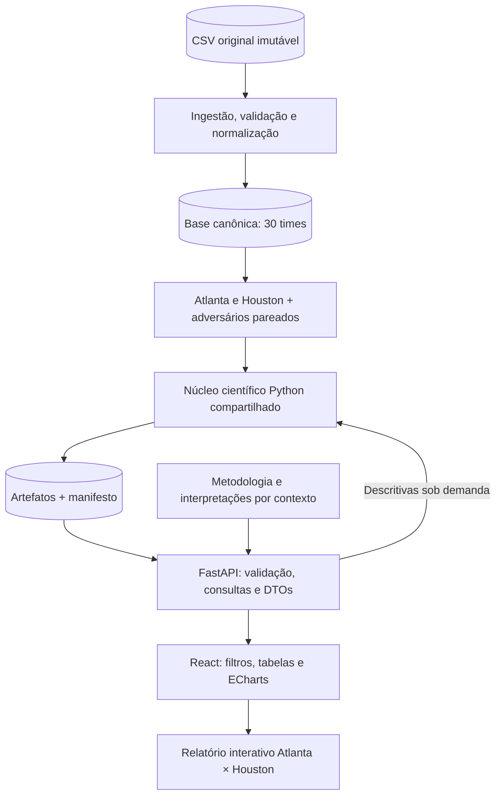

# QuadraScope — Arquitetura do sistema

> Projeto 1 de Laboratório de Ciência de Dados — UFAPE, 2026.2. Revisão: 29/10/2026.
> Estado: etapas 0–4 concluídas. Ingestão, qualidade, descritivas e dados dos gráficos implementados; demais detectores, endpoints e frontend ainda pendentes.

## Objetivo e escopo

O QuadraScope será um relatório científico interativo sobre **Atlanta Hawks e Houston Rockets**, com resultados, métodos, interpretações e limitações dentro da aplicação. A pergunta central é como os dois times diferem em desempenho típico, dispersão e partidas atípicas no recorte fornecido.

As sete variáveis obrigatórias são **PTS, REB, AST, STL, BLK, PF e FG3M**. Cada uma terá análise por time e comparação entre os times. Preservar os 30 times na base canônica permite recuperar adversários e contexto; o fluxo principal será Atlanta × Houston.

Históricos dos times e confrontos diretos são análises distintas. Existem apenas dois confrontos diretos no CSV; não apresentar esse subconjunto como evidência suficiente de superioridade geral.

Rankings da liga, seleção de quatro times, evolução temporal e normalização por tempo são extensões posteriores aos requisitos obrigatórios. Previsão de partidas e análises de jogadores ficam fora desta entrega.

Documentos complementares:

- [Ambiente de desenvolvimento e comandos](../development/setup.md).
- [Ingestão e normalização](../development/ingestion.md).
- [Qualidade, cobertura e enriquecimento](../development/quality.md).
- [Descritivas, boxplots e distribuições](../development/descriptive.md).
- [Metodologia e regras científicas](../data/methodology.md).
- [Requisitos, rastreabilidade e acompanhamento](../planning/requirements.md).
- [Plano detalhado de implementação, do início à entrega](../planning/implementation-plan.md).
- [Dicionário e transformação das 28 colunas](../data/data-dictionary.md).
- [Proveniência e extração do CSV](../data/provenance.md).
- [Diagrama](diagrams/quadrascope-arquitetura.svg), gerado da [fonte Graphviz](diagrams/architecture.dot).

## Fonte do diagrama: o que é architecture.dot?

O arquivo [architecture.dot](diagrams/architecture.dot) descreve os nós, as conexões e o estilo do diagrama na linguagem DOT do Graphviz. É a fonte editável; o [SVG](diagrams/quadrascope-arquitetura.svg) é a imagem gerada para leitura. Não faz parte do código da aplicação e não é necessário para executá-la.

Para alterar o diagrama, editar o DOT e regenerar o SVG, mantendo ambos versionados. Com Graphviz instalado, executar da raiz do repositório:

```bash
dot -Tsvg docs/architecture/diagrams/architecture.dot -o docs/architecture/diagrams/quadrascope-arquitetura.svg
```

## Evidências da base

Auditoria exploratória em 29/10/2026 sobre [data/raw/stats_times_regular_final.csv](../../data/raw/stats_times_regular_final.csv):

| Verificação | Resultado |
| --- | --- |
| Dimensões | 2.238 linhas × 28 colunas |
| Granularidade | Time-partida; chave `(Team_ID, Game_ID)` |
| Cobertura | 30 times, 1.119 partidas, exatamente duas linhas por partida |
| Período global | 21/10/2025 a 29/03/2026 |
| Missing / duplicatas de linha / duplicatas da chave | 0 / 0 / 0 |
| Identidades de pontos e rebotes | Nenhuma divergência |
| Convertidos ≤ tentados e percentuais com tolerância de arredondamento | Nenhuma divergência nas verificações realizadas |
| Resultado | Uma vitória por partida; WL coerente com o placar pareado |
| Zeros em BLK e STL | 33 e 1 registros de time-partida, respectivamente |
| Tamanho | 309.357 bytes |
| SHA-256 | `fa56bf638ef18be972a88850719043953e615bf39339671a8daa007ba08811b6` |

| Time | ID | Jogos | V–D | Casa / fora | Jogos com prorrogação | Período |
| --- | --- | --- | --- | --- | --- | --- |
| Atlanta Hawks | `1610612737` | 75 | 42–33 | 38 / 37 | 2 | 22/10/2025–28/03/2026 |
| Houston Rockets | `1610612745` | 74 | 45–29 | 35 / 39 | 8 | 21/10/2025–29/03/2026 |

O recorte soma 149 linhas e 147 partidas distintas. Os contadores acumulados dos dois times são coerentes com a sequência observada. Consistência interna não comprova autenticidade ou completude em relação à fonte original. O grupo confirmou em 29/10/2026 que são dados reais da NBA 2025–26, obtidos da API oficial da NBA via `nba_api` em Python. Data exata da extração, endpoints, parâmetros e tratamentos prévios não foram informados; ver [proveniência](../data/provenance.md).

`MIN` contém minutos agregados dos jogadores (240, 265, 290), compatíveis com zero, uma ou duas prorrogações. Preservar totais originais e mostrar esse contexto. Prorrogações, calendários e exposição casa/fora limitam interpretações causais das comparações. Zero células ausentes não significa temporada completa.

## Decisões técnicas

| Área | Decisão |
| --- | --- |
| Frontend | React + TypeScript + Vite; Node 24 previsto para build |
| Design | Tailwind CSS + shadcn/ui; componentes Radix necessários sem abstrações duplicadas |
| Gráficos | Apache ECharts + echarts-for-react, recebendo estatísticas prontas do Python |
| Tabelas | TanStack Table e formatação centralizada |
| Estado remoto | TanStack Query + fetch; cache por versão, filtros e parâmetros |
| Navegação | React Router; filtros compartilháveis por URL |
| Backend | Python 3.12 + FastAPI + Pydantic; tipos TypeScript futuramente gerados pelo OpenAPI |
| Ciência de dados | pandas, NumPy, SciPy, scikit-learn; ECOD próprio validado contra referência |
| Persistência | CSV imutável, Parquet no pipeline, JSON de resultados; sem banco inicialmente |
| Verificação futura | pytest para cálculos/API, Vitest para interações relevantes |
| Qualidade | Ruff, ESLint, Prettier e dependências fixadas |
| Deploy | Validar FastAPI e frontend na Vercel com dependências e artefatos reais |

**FastAPI + React está confirmado pelo grupo**, com validação externa comunicada em 29/10/2026 (P0.07). FastAPI foi escolhido pelos contratos tipados, validação com Pydantic e documentação OpenAPI. React será a apresentação; o serviço web e toda a análise científica serão Python. A justificativa também deverá aparecer na página de dados e no README final; R01 permanece parcial até sua implementação e apresentação no sistema.

## Responsabilidades e fluxo



| Componente | Responsabilidade |
| --- | --- |
| Ingestão/qualidade | Tipar, validar, registrar transformações e bloquear artefatos inválidos |
| Repositório de dados | Leitura, seleção e pareamento de adversários; sem fórmulas estatísticas |
| Registro de métricas | Nome, coluna, tipo, unidade, domínio, elegibilidade e apresentação |
| Núcleo científico | Funções determinísticas para descritivas, distribuições e detectores; sem HTTP |
| Serviços | Política de filtros/referência, composição de respostas e evidências |
| Conteúdo analítico | Interpretações, metodologia e limitações vinculadas ao contexto |
| API | Parâmetros, serialização, versões e erros |
| React | Navegação, estado, acessibilidade e formatação |

Pipeline offline e API usam as mesmas funções científicas. Não haverá fórmulas duplicadas no navegador ou nos endpoints. Interpretações devem usar os resultados atuais ou identificar explicitamente o contexto fixo; conclusões da temporada inteira não serão reutilizadas em filtros diferentes.

## Artefatos e reprodução

O build produzirá base canônica, descritivas/distribuições por time, resultados dos detectores, qualidade e manifesto. Parquet é interno; o runtime pode consumir apenas JSON quando isso atender à interatividade. Caso haja descritivas online, empacotar suas dependências e medir custo real.

Manifesto: hash do dataset, `schema_version`, `analysis_version`, revisão do código, dependências, parâmetros, ordem das variáveis, data UTC da geração e hashes dos artefatos. Dataset e versão da análise são identidades distintas. Timestamps de geração ficam fora da comparação de conteúdo determinístico.

Gerar artefatos antes do deploy. A aplicação consulta arquivos de leitura e não depende de escrita persistente no disco da hospedagem. Não publicar artefatos parciais ou incompatíveis com os schemas.

## Navegação e relatório

| Página | Conteúdo |
| --- | --- |
| `/` — Síntese | Atlanta × Houston; conclusões, cobertura, limitações e links para evidências |
| `/times/:team_id` — Perfil | Sete variáveis, medidas completas, boxplot, histograma/KDE e interpretações |
| `/comparar` — Comparação | Barras na mesma unidade, quadros de CV/IQR e discussão de regularidade |
| `/fora-da-curva` — Anomalias | Métodos, quantidades, registros, scores, parâmetros e referência |
| `/dados` — Dados e métodos | Dicionário, tipos, transformações, qualidade, missingness e fórmulas |

`/times` pode direcionar para os dois perfis principais. Evolução temporal é extensão. As páginas indicarão os itens acadêmicos atendidos; documentação no repositório não substitui sua publicação no sistema.

Gráficos terão título, eixos, unidades e legenda quando aplicável. Formatação uniforme: observações de contagem inteiras, medidas derivadas com duas casas, CV em percentual com duas casas. Variância usa unidade²; assimetria é adimensional. Tabelas acessíveis acompanham os gráficos.

## Filtros e referência

Datas inclusivas; condição `all|home|away`; resultado `all|win|loss`. Estado na URL. Comparações aplicam a mesma seleção aos dois times, mostrando n e cobertura efetivos de cada um.

**Descritivas:** recalcular sobre as linhas selecionadas. **Detectores no MVP:** ajustar sobre o histórico completo de cada time neste dataset e filtrar somente a exibição. Informar “anomalia em relação ao histórico completo do time neste dataset”, `reference_n` e `display_n`.

Não recalcular detectores silenciosamente. Uma opção futura de recálculo exigirá referência explícita e validação de amostra/parâmetros. Scores ajustados separadamente por time não compõem ranking absoluto comum.

## Contratos previstos

Prefixo `/api/v1`, rotas de leitura:

| Rota | Finalidade |
| --- | --- |
| `/meta` | Versões, métricas, times principais e cobertura |
| `/dictionary` | As 28 colunas, tipos, nomes e transformações |
| `/teams` | Dois times principais e demais times identificados como contexto |
| `/teams/{team_id}/summary` | Descritivas das sete variáveis no filtro |
| `/distributions?team_id=...&metric=PTS` | Histograma, KDE, boxplot e outliers com registros |
| `/comparisons?team_ids=1610612737,1610612745&metric=PTS` | Resultados comparáveis e quadros de dispersão |
| `/anomalies?team_id=...&method=iqr&metric=PTS` | Análise univariada |
| `/anomalies?team_id=...&method=lof&features=PTS,REB,AST,STL,BLK,PF,FG3M` | Análise multivariada |
| `/quality` | Regras, contagens por coluna e tratamento |
| `/interpretations?context=...` | Textos e evidências para o contexto solicitado |
| `/health` | Disponibilidade e versão dos artefatos |

`from`, `to`, `venue` e `outcome` aplicam-se às consultas analíticas. `/quality` identifica separadamente base completa e recorte do grupo. No MVP, `features` multivariado aceita somente a lista canônica completa; outras seleções são rejeitadas até haver artefatos validados. Endpoints analíticos do MVP aceitam somente os dois times principais; os demais IDs são usados como contexto e identificados como fora do escopo analítico.

Toda resposta analítica identifica dataset, versão da análise, times, variável(s), unidade, método, parâmetros, período, filtros, referência, n e avisos. Anomalias incluem `reference_n`, `display_n`, registros da partida, score, direção e limiar quando existente. DBSCAN não recebe score contínuo inventado.

Medidas têm estados `ok`, `empty`, `insufficient_sample`, `constant_series` ou `not_applicable`, com motivo. Valores indefinidos são `null`, nunca NaN/infinito. Modas são listas com frequência e convenção. Grubbs retorna candidato, G, valor crítico e decisão, não remoção iterativa.

Validar datas, IDs, métricas e combinações método/variáveis por allowlist. ID inexistente: 404. Consulta inválida ou análise fora do escopo: 422. Seleção válida vazia: 200 com estado `empty`. Artefato obrigatório ausente/incompatível: 503. Não confundir indisponibilidade com ausência de observações.

Tipos do frontend derivados de OpenAPI; chaves de cache incluem dataset, versão e todos os parâmetros. Invalidar cache quando a versão mudar. Não arredondar resultados intermediários; UI aplica a formatação.

## Organização proposta

```text
quadrascope/
├── README.md
├── pyproject.toml              # dependências, Ruff e pytest
├── uv.lock                     # resolução completa de runtime e dev
├── requirements.txt            # exportação de runtime com hashes
├── Makefile                    # comandos locais
├── data/                       # dados compartilhados; fora de docs e do código
│   ├── raw/                    # CSV original preservado, já existente
│   └── processed/              # artefatos futuros do pipeline
├── docs/
│   ├── README.md               # índice da documentação
│   ├── architecture/
│   │   ├── architecture.md     # fonte principal da arquitetura
│   │   └── diagrams/           # fonte DOT e diagrama SVG
│   ├── development/            # instalação, comandos e verificações
│   ├── data/                   # proveniência, dicionário e metodologia
│   ├── planning/               # requisitos e plano de implementação
│   └── references/             # enunciado acadêmico original
├── frontend/src/               # a implementar
│   ├── app/                    # providers, layout e rotas
│   ├── features/               # synthesis, teams, compare, anomalies, data
│   ├── components/             # gráficos, tabelas e estados acessíveis
│   ├── lib/                    # HTTP, URL e formatação
│   └── generated/              # tipos OpenAPI
└── backend/                    # estrutura criada na etapa 1
    ├── app/                    # API, schemas e serviços
    ├── analytics/              # funções científicas compartilhadas
    ├── repositories/           # leitura e consulta em ../data/
    ├── content/                # textos contextualizados
    ├── scripts/                # build e validação
    └── tests/                  # casos científicos e contratos
```

As etapas 1–2 criaram ambiente e normalização em `data/processed/ingestion/`. A etapa 3 gera diagnóstico e intermediários enriquecidos em `data/processed/quality/`, somente após aprovação das regras internas. Esses arquivos não são o conjunto final de publicação. A etapa 4 calcula descritivas, boxplots e distribuições em `data/processed/descriptive/`, com estados por medida e metadados. Demais detectores, API e frontend pertencem às próximas etapas. Evitar um segundo arquivo de arquitetura concorrente.

## Entrega e pendências

Validar hospedagem com roteamento `/api`, recarga de rotas React, tamanho do pacote, artefatos, cold start e duração das consultas. Vercel Services consta como beta na documentação consultada em 29/10/2026; adoção depende da prova prática. Alternativa: dois projetos com CORS limitado à origem publicada. Não registrar deploy como concluído sem URL testada.

O README futuro terá versões necessárias, `requirements.txt`, preparação de artefatos e comando único de execução local. A aplicação deve estar acessível para avaliação, com instruções locais como alternativa prevista no enunciado. Sem banco, filas ou microsserviços sem necessidade demonstrada.

Confirmados: origem NBA via `nba_api` (com detalhes de coleta não informados documentados) e stack FastAPI + React. Pendências técnicas: validação dos parâmetros candidatos e topologia final da hospedagem. Publicação dos resultados depende da validação correspondente.

Referências: [FastAPI na Vercel](https://vercel.com/docs/frameworks/backend/fastapi), [Vercel Services](https://vercel.com/docs/services). Referências científicas estão na [metodologia](../data/methodology.md).
